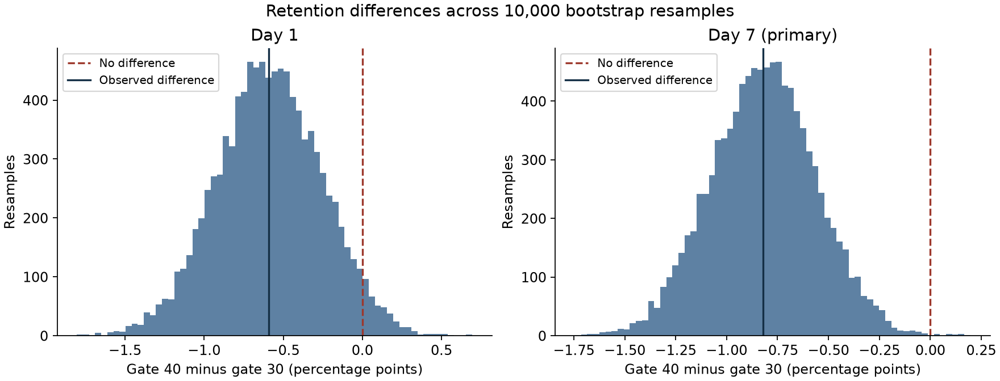
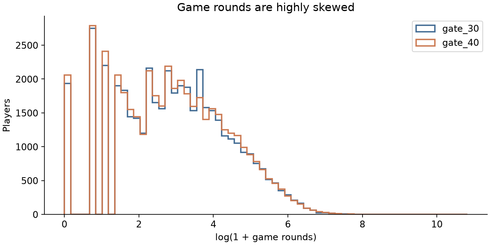

# Cookie Cats A/B Test: Player Retention

**Should the first progression gate move from level 30 to level 40?**
This reproducible analysis compares retention for **90,189 assigned players**.
Moving the gate to level 40 is associated with a **0.82 percentage point decrease
in Day 7 retention**. The recommendation is to retain level 30 while investigating
the allocation imbalance and the missing revenue trade-off.

This is an independent, AI-assisted reproduction of a public experiment,
inspired by [Quantique-Realm's reference analysis](https://github.com/Quantique-Realm/cookie-cats-ab-test).
See [attribution](ATTRIBUTION.md) and [dataset provenance](data/README.md).

## Verified results

All differences below are gate 40 minus gate 30. The main analysis includes every
assigned player, including zero-round players and the extreme engagement observation.

| Metric | Gate 30 | Gate 40 | Difference | 95% confidence interval | Two-sided p-value |
|---|---:|---:|---:|---:|---:|
| Day 7 retention (primary) | 19.02% | 18.20% | -0.82 pp | -1.33 to -0.31 pp | 0.0016 |
| Day 1 retention (supporting) | 44.82% | 44.23% | -0.59 pp | -1.24 to +0.06 pp | 0.0744 |

Gate 30 has 44,700 players; gate 40 has 45,489. The 50/50 allocation check gives
**p = 0.0086**. Assignment logs are unavailable, so this remains a diagnostic
caveat. It does not by itself establish a randomization failure.



## Run locally

Tested with Python 3.14 and the pinned packages in `requirements.txt`.
From the repository root:

```bash
python -m venv .venv
# Windows PowerShell: .\.venv\Scripts\Activate.ps1
# macOS/Linux: source .venv/bin/activate
python -m pip install -r requirements.txt
python download_data.py
python analyze.py
python -m unittest discover -s tests -v
```

The raw dataset stays local. The downloader verifies a SHA-256 checksum and uses
a pinned public CSV mirror. You can also download the file from
[Kaggle](https://www.kaggle.com/datasets/yufengsui/mobile-games-ab-testing)
and run `python analyze.py path/to/cookie_cats.csv`.

Outputs are `reports/results.json`, `reports/results.md`, and `reports/figures/`.
Use `--seed 42 --iterations 10000` to reproduce the default bootstrap.
The walkthrough is [notebooks/cookie_cats_ab.ipynb](notebooks/cookie_cats_ab.ipynb).
To rerun it interactively, install Jupyter separately with `python -m pip install notebook`.

## Analysis choices

- Validate IDs, required values, the two group labels, non-negative integer rounds,
  and binary retention flags. Invalid records cause an error instead of silent deletion.
- Treat Day 7 as the primary decision metric in this retrospective reproduction.
  Day 1 supplies supporting evidence; this is not a historically preregistered plan.
- Use a pooled two-proportion z-test for the null hypothesis and an unpooled
  normal 95% interval for the difference. The large group counts support the approximation.
- Use 10,000 independent within-group bootstrap resamples. For a binary outcome,
  sampling a binomial count at the empirical rate is exactly equivalent to
  resampling individual outcomes with replacement.
- Check sensitivity to removing the maximum-round observation, and separately
  to excluding zero-round players. The latter conditions on post-assignment
  behavior and is descriptive, not a replacement causal analysis.

The observed Day 7 change is about **-4.3% relative** to gate 30's retention.
This is a measured difference, not an achieved improvement or a revenue estimate.
The bootstrap fraction favoring a group is not a posterior probability.
Day 1's non-significant result does not prove that early retention is unchanged.



## Files

| File | Purpose |
|---|---|
| `analyze.py` | Validation, inference, sensitivity checks, report and charts |
| `download_data.py` | Pinned dataset download with checksum verification |
| `notebooks/cookie_cats_ab.ipynb` | Executed analysis walkthrough |
| `reports/results.json` | Full numerical results and configuration |
| `reports/results.md` | Generated decision summary and limitations |
| `tests/test_analysis.py` | Statistical cross-checks and invalid-input checks |

## Limits

There are no revenue measurements, assignment logs, exposure records, or longer-term
retention measures. We cannot identify who actually reached a gate. The large
round count may be unusual without being demonstrably erroneous. This analysis
supports a retention recommendation, not a claim of increased company revenue.
